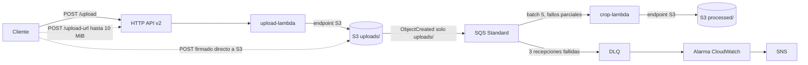

# Procesador de imagenes en AWS

Implementacion del diagrama proporcionado para un entregable academico. Terraform crea
la misma arquitectura en **DEV, QA y PROD**, con estados independientes. La API recibe
una imagen, S3 almacena el original, SQS desacopla el procesamiento y una Lambda genera
un PNG circular **40 x 40 px con fondo transparente**.

## Estado del entregable

Repositorio: [jordan4-debug/aws-image-processor](https://github.com/jordan4-debug/aws-image-processor).
El codigo y las pruebas locales estan preparados. Consultar `docs/ESTADO.md` para
el estado del despliegue y la destruccion. La guia `docs/GUIA-EXPLICACION.md` ayuda
a entender y explicar la implementacion; las evidencias deben ser ejecuciones reales.

## Arquitectura



El diagrama original completo esta en `docs/architecture-original.mermaid`.
Region: **us-east-1**. VPC `10.0.0.0/16`; subredes publicas `10.0.1.0/24` y
`10.0.2.0/24`; privadas `10.0.11.0/24` y `10.0.12.0/24`; dos NAT Gateways;
endpoint Gateway S3 y endpoint Interface SQS. Lambdas sin ingreso y salida HTTPS
solo a S3 y al endpoint SQS. Cada funcion usa **las dos subredes privadas**: las
replicas del diagrama representan disponibilidad multi-AZ de Lambda, no cuatro
funciones distintas.

S3 privado, AES-256, versionado, TLS obligatorio, expiracion 30 dias para originales
y 90 dias para procesadas. SQS: visibilidad 360 s, retencion 1 dia, polling 20 s,
DLQ despues de 3 recepciones; DLQ con retencion 14 dias. Logs 14 dias; alarma
de DLQ con periodo 60 s y umbral > 0 publica en SNS.

## Decisiones y limites que deben declararse al docente

1. **10 MB en POST /upload:** API Gateway admite payload de 10 MB, pero la
   invocacion sincrona de Lambda admite 6 MB, incluyendo el evento y base64. No
   es posible garantizar una imagen de 10 MB con ese trayecto exacto.
   Se conserva `/upload` para JSON y multipart con limite seguro de **4 MiB de
   archivo** y se agrega `/upload-url` para obtener un **POST firmado a S3** de
   hasta **10 MiB (10485760 bytes)**. Las condiciones firmadas limitan tamano,
   tipo y cifrado; el bucket sigue privado. La ruta complementaria debe declararse
   en la entrega y confirmar su aceptacion si se exige fidelidad literal al flujo.
2. **Node.js 20:** el runtime del diagrama esta deprecado. Se deja `nodejs20.x`
   para fidelidad y como variable; cambiar a `nodejs22.x` o `nodejs24.x` si el
   docente permite actualizarlo o AWS bloquea su creacion. No se modifica
   silenciosamente el requisito. Las pruebas locales usan el Node disponible.
3. **SQS:** el servicio de Lambda sondea SQS y elimina mensajes exitosos mediante
   el event source mapping. El handler no implementa un segundo consumidor.
   Se conserva el endpoint SQS y los permisos solicitados en el diagrama.
4. **Alta disponibilidad:** cada subred privada enruta a su NAT de la misma AZ.
   No se implementa conmutacion automatica entre NATs; eso no esta especificado.
5. **SNS:** se crea el topico y la accion de alarma. El email es opcional y requiere
   confirmar la suscripcion por correo. Sin suscriptor hay publicacion al topico,
   pero no entrega a una bandeja de entrada.
6. El limite de API de 10000 rps es configuracion, **no una prueba de rendimiento
   ni garantia de capacidad**. La cuota de cuenta/regional puede ser inferior.
   El procesamiento SQS se limita a dos invocaciones simultaneas para la demo.
7. PROD es un entorno academico. La API publica sin autenticacion reproduce el
   diagrama; para uso real se debe disenar autenticacion y controles adicionales.

Fuentes oficiales:
- [Cuotas HTTP API](https://docs.aws.amazon.com/apigateway/latest/developerguide/http-api-quotas.html)
- [Cuotas Lambda](https://docs.aws.amazon.com/lambda/latest/dg/gettingstarted-limits.html)
- [Runtimes Lambda](https://docs.aws.amazon.com/lambda/latest/dg/lambda-runtimes.html)
- [Configuracion SQS-Lambda](https://docs.aws.amazon.com/lambda/latest/dg/services-sqs-configure.html)
- [Instalacion multiplataforma sharp](https://sharp.pixelplumbing.com/install/)

## Estructura

```text
src/upload/              Lambda de carga y POST firmado
src/crop/                Lambda de recorte con sharp 0.33.5
terraform/modules/       Infraestructura reutilizable
terraform/environments/  Raices y estados separados: dev, qa, prod
scripts/                 Empaquetado, pruebas reales y evidencias
tests/                   Pruebas automatizadas de la aplicacion
docs/                    Diagrama, decisiones y checklist de PDF
evidence/                Evidencias por entorno, excluidas de Git
```

## Requisitos

- Cuenta AWS activa con permisos para los recursos del diagrama.
- Terraform >= 1.6 y < 2; proveedor AWS 6.x fijado con `.terraform.lock.hcl`.
- Node.js >= 20.9 y npm. El empaquetado apunta a **Linux x64/glibc**, incluso desde Windows.
- AWS CLI con sesion autenticada, o **AWS CloudShell** que usa tu sesion de consola.
- No guardar ni subir claves, credenciales, estados Terraform ni archivos de planes a Git.

## Ruta recomendada: AWS CloudShell

CloudShell permite ejecutar la entrega sin instalar AWS CLI local ni compartir claves.
Abrir CloudShell desde la consola y clonar el repositorio:

```bash
git clone https://github.com/jordan4-debug/aws-image-processor.git
cd aws-image-processor
bash scripts/prepare-cloudshell.sh
```

Este paso instala dependencias, ejecuta pruebas e inicializa Terraform. **No crea
los recursos de la arquitectura**. Descarga Terraform desde HashiCorp y comprueba SHA-256.

Planificar y revisar DEV:

```bash
bash scripts/run-environment.sh dev plan
```

Una vez revisado y autorizado el plan:

```bash
bash scripts/run-environment.sh dev apply
bash scripts/run-environment.sh dev verify
```

`verify` prueba JSON, multipart, POST firmado y un PNG valido de exactamente
10 MiB por el trayecto S3. Descarga cada resultado privado mediante la identidad
del operador y verifica dimensiones, formato y transparencia; escribe JSON y PNG
en `evidence/dev/`. Si la cuenta bloquea un recurso, guardar el error y resolver
la limitacion; no cambiar al plan de pago automaticamente.

Para mostrar un resumen de los archivos reales y tomar capturas:

```bash
node scripts/show-evidence.cjs dev infrastructure
node scripts/show-evidence.cjs dev verification
node scripts/show-evidence.cjs dev monitoring
```

Despues de capturar evidencias, eliminar DEV:

```bash
bash scripts/run-environment.sh dev destroy
```

El script guarda un **plan de destruccion**, ejecuta `terraform destroy`, guarda
logs y exige estado vacio y ausencia de recursos en AWS, incluidos API, roles IAM,
SNS, logs, NATs, endpoints e IPs publicas. El resumen final se muestra con
`node scripts/show-evidence.cjs dev destroy`. Tambien se puede usar manualmente:

```bash
terraform -chdir=terraform/environments/dev destroy -no-color
terraform -chdir=terraform/environments/dev state list
```

Repetir plan, apply, verify, capturas y destroy para **qa** y **prod**, uno por uno.
Esto evita mantener seis NAT Gateways al mismo tiempo y posibles limites de IPs.
No destruir antes de descargar las evidencias.

## Preparacion local en Windows

Desde PowerShell, en la carpeta del proyecto:

```powershell
npm.cmd ci
npm.cmd --prefix src/upload ci
npm.cmd --prefix src/crop ci --include=optional
npm.cmd test
npm.cmd run build
terraform fmt -check -recursive
terraform -chdir=terraform/environments/dev init
terraform -chdir=terraform/environments/dev validate
```

Para un despliegue local hay que configurar el acceso AWS primero. Una cuenta
abierta en el navegador no autentica automaticamente Terraform local. Preferir
sesiones temporales y no crear claves de usuario root.

Las raices guardan estado local separado. Conservarlo para poder destruir.
En equipos compartidos o CI, configurar un backend remoto S3 con bloqueo y
permisos apropiados antes del despliegue; no compartir el estado por Git.

## API

### JSON con base64

```json
{"filename":"foto.png","contentType":"image/png","base64":"BASE64_PURO_DEL_ARCHIVO"}
```

Enviar a `POST /upload` con `Content-Type: application/json`. Respuesta HTTP 202
con `key` y `processedKey`. No devuelve la imagen inmediatamente: SQS la procesa
de manera asincrona.

### Multipart

```bash
curl -X POST 'https://API.execute-api.us-east-1.amazonaws.com/upload' -F 'file=@foto.png;type=image/png'
```

### Archivos hasta 10 MiB

Enviar a `POST /upload-url`:

```json
{"filename":"foto.png","contentType":"image/png","size":10485760}
```

La respuesta incluye `url`, `fields`, `key`, `processedKey` y caducidad 300 s.
Enviar un formulario multipart a esa `url`, todos los `fields` y el archivo
**al final** del formulario. El script demo automatiza este procedimiento.
S3 comprueba condiciones firmadas; crop valida el contenido real y dimensiones
de entrada. Un archivo corrupto cargado por esta ruta ira a la DLQ tras reintentos.
GIF animado se procesa usando el primer frame.

## Probar errores y DLQ

```bash
node scripts/failure-demo.cjs dev
```

Carga solo un archivo de prueba corrupto en el bucket del proyecto. No reducir
el timeout para acelerar la evidencia: con visibilidad de 360 s y tres recepciones
fallidas, la DLQ puede tardar unos **18 minutos**, mas el intervalo de alarma.
Consultar la DLQ y la alarma despues; guardar logs reales. No consumir ni purgar
la DLQ durante la captura. El procesamiento de eventos SQS es al menos una vez;
las claves de salida son deterministas, aunque versionado puede guardar otra
version si AWS repite el evento.

## Costos y limpieza

NAT Gateways, sus direcciones publicas y endpoint Interface consumen creditos
por tiempo y/o trafico. No son recursos gratuitos ilimitados. Desplegar por pocas
horas y destruir tras capturar. Consultar [precios VPC](https://aws.amazon.com/vpc/pricing/)
y [precios PrivateLink](https://aws.amazon.com/privatelink/pricing/) antes de aplicar.

`force_destroy_test_bucket = true` permite borrar originales, procesados y todas
sus versiones al destruir. Solo usar datos de prueba. En un PROD real cambiar a
`false` y disenar respaldo/retencion. No borrar el estado ni la carpeta de CloudShell
antes de destruir; si apply falla a medias, Terraform conserva recursos creados
y se debe ejecutar destroy desde la misma raiz.
